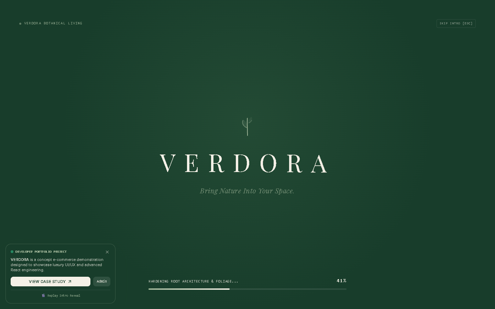
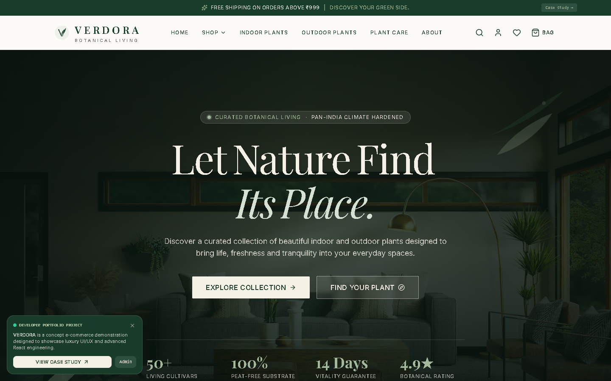
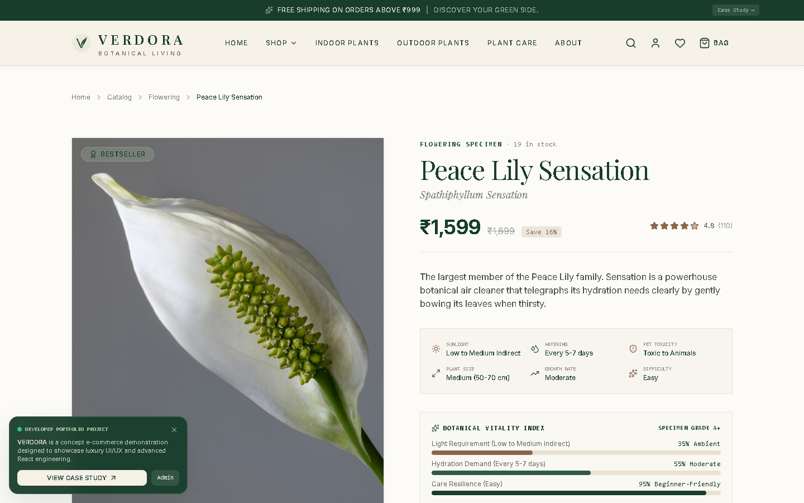
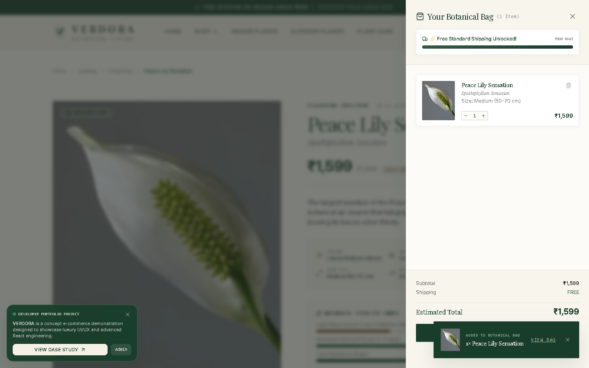
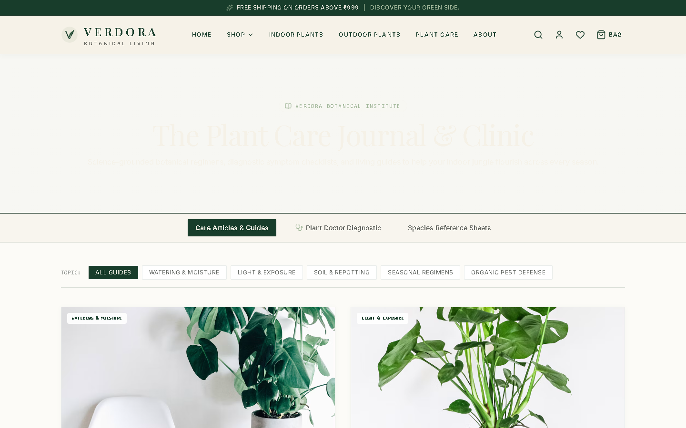
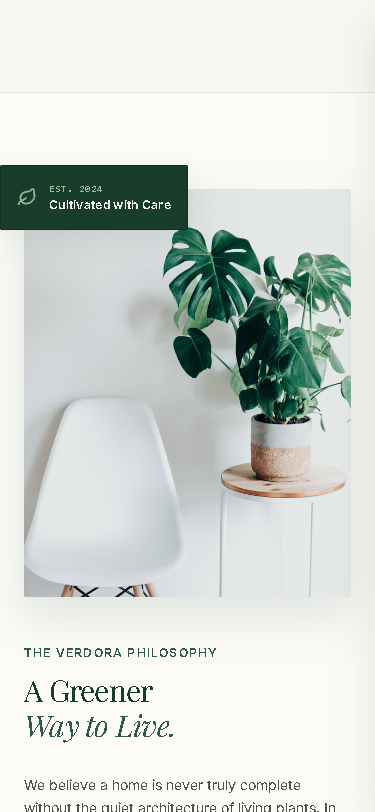

<div align="center">

```
  __      ________ _____  _____   ____  _____            
  \ \    / /  ____|  __ \|  __ \ / __ \|  __ \   /\      
   \ \  / /| |__  | |__) | |  | | |  | | |__) | /  \     
    \ \/ / |  __| |  _  /| |  | | |  | |  _  / / /\ \    
     \  /  | |____| | \ \| |__| | |__| | | \ \/ ____ \   
      \/   |______|_|  \_\_____/ \____/|_|  \_\_/    \_\ 
```

### *Bring Nature Into Your Space.*

**A fictional luxury botanical e-commerce maison and living flora showcase designed to demonstrate agency-level UI/UX design, custom design tokens, and frontend engineering.**

[](https://vitejs.dev/)
[](https://react.dev/)
[](https://tailwindcss.com/)
[](https://www.framer.com/motion/)
[](https://verdora-botanical.vercel.app)
[](LICENSE)

<br />

### 🌿 [Launch Live Storefront](https://verdora-botanical.vercel.app) &nbsp;•&nbsp; 📖 [View Portfolio Case Study](https://verdora-botanical.vercel.app/portfolio) &nbsp;•&nbsp; 🔐 [Admin Atelier Portal](https://verdora-botanical.vercel.app/admin)

---

</div>

<br />

## 📸 Visual Gallery

<div align="center">

| 🎬 Cinematic Editorial Preloader | 🌿 Atmospheric Parallax Hero |
| :---: | :---: |
|  |  |

| 🪴 Interactive Specimen Detail & Vitality Index | 🛍️ Fluid Cart Drawer & Free Shipping Bar |
| :---: | :---: |
|  |  |

| 🩺 Plant Care Clinic & Diagnostic Doctor | 📱 Adaptive Mobile Architecture (Zero-Overflow) |
| :---: | :---: |
|  |  |

</div>

<br />

## 🌿 Project Overview

**VERDORA** is a concept e-commerce platform crafted to showcase senior-level frontend capabilities. Inspired by luxury botanical publications (*Kinfolk, Aesop, Cereal*), VERDORA replaces generic e-commerce conventions with editorial asymmetry, atmospheric parallax depth, physics-based micro-interactions, and genuine botanical science.

### 🎯 Primary Objectives Demonstrated
1. **Exceptional UI/UX Design:** Bespoke brand identity, consistent editorial grid, harmonious color harmony, and museum-grade typography.
2. **Advanced Frontend Architecture:** Clean component modularity, scalable context providers, and deterministic state transitions.
3. **Motion & Interaction Design:** Smooth cubic-bezier page wipes, word-by-word blur reveals, layout physics reordering, and tactile micro-springs via Framer Motion.
4. **Full E-Commerce Journey:** 18 fully functional routes spanning discovery, filtering, search, quick-view modals, cart drawer, Razorpay checkout simulation, and 4-stage logistics telemetry tracking.

---

## 🎨 Design System & Color Tokens

VERDORA operates on an earthy, grounding palette inspired by botanical greenhouse conservatories:

| Token Name | Hex Code | Swatch | Application |
| :--- | :--- | :--- | :--- |
| **Forest Green** | `#183D2B` |  | Primary brand anchor, headers, hero backgrounds |
| **Botanical Green** | `#315B40` |  | Secondary accents, vitality highlights, badge active states |
| **Sage** | `#A3B89B` |  | Delicate flourishes, tag indicators, subtle borders |
| **Warm Cream** | `#F5F1E7` |  | Primary canvas contrast, cards, editorial quote backdrops |
| **Off White** | `#FCFBF7` |  | Primary viewport background, clean breathability |
| **Earth Brown** | `#8A674B` |  | Warm terracotta accents, save discount chips, alert badges |

### ✒️ Typography
* **Primary Editorial Display:** `Playfair Display` (Serif — elegance, prestige, botanical history).
* **Body & Interface:** `Inter` (Sans-Serif — precision readability, clean hierarchy).
* **Telemetry & Metrology:** `JetBrains Mono` (Monospace — care schedules, SKU tracking, sensor metrics).

---

## ✨ Key Feature Highlights

### 1. 🎬 Cinematic Editorial Preloader & Intro Reveal
* First-time visitor detection using `sessionStorage`.
* Animated SVG sprout emblem with live stroke path rendering.
* Letter-by-letter staggered typography expansion (`V E R D O R A`).
* Monospace live counter (`01% → 100%`) with dynamic botanical progress tickers.
* Luxury theatre curtain wipe exit (`y: -100%`) with cubic-bezier ease.
* Interactive **[Esc to Skip]** capability and instant **"🎬 Replay Intro Reveal"** trigger on the portfolio badge.

### 2. 🪴 Living Botanical Catalog & Dynamic Grid Physics
* Multi-parameter filter engine (Light requirement, Care difficulty, Size, Pet safety, Air purification, Rare drops).
* Real-time search modal with keyboard shortcut (`Ctrl + K`).
* Re-layout animations powered by Framer Motion's `layout` physics — items glide seamlessly into place when filter chips are toggled.
* Dual-photo crossfade on hover and morphing quick-add button (`+` $\rightarrow$ `✓`).

### 3. 📊 Botanical Vitality Index (`ProductDetail.jsx`)
* Specimen Grade A+ breakdown for each plant specimen.
* Animated liquid progress bars visualizing:
  * **Light Requirement (Ambient Lux %)**
  * **Hydration Regimen (Frequency Demand %)**
  * **Care Resilience & Beginner Ease (%)**
* Gliding tab bar using `layoutId` spring indicators.

### 4. 🧭 Interactive 4-Step Plant Finder Quiz
* Step-by-step diagnostic questionnaire tailored for interior lighting, pet safety, watering habits, and space scale.
* Animated transition between quiz steps.
* Scored algorithmic recommendation engine displaying personalized plant matches.

### 5. 🩺 Plant Doctor Symptom Clinic
* Diagnostic tool for troubled plants with visual distress signal selectors (Yellowing leaves, Brown tips, Drooping, Pests).
* Instant root-cause identification and botanist treatment protocols.

### 6. 💳 Complete Demonstration Checkout & Order Telemetry
* Realistic Razorpay modal simulation with live OTP generation, NetBanking, Cards, and UPI validation.
* 4-Stage botanical logistics timeline tracking courier coordinates, moisture cocoon wrap status, and transit temperature.

### 7. 🔐 Protected Atelier Admin Command Center
* Live gross revenue KPIs, fulfillment status switches, stock increment/decrement, and product management.

---

## 🏗️ Project Architecture

```
verdora/
├── docs/                      # Screenshots & portfolio documentation
│   └── screenshots/
├── public/                    # High-resolution botanical assets
│   └── plants/                # Verified authentic photography
├── src/
│   ├── components/
│   │   ├── brand/             # SVG logo variants & wordmarks
│   │   ├── checkout/          # Razorpay simulation modal & forms
│   │   ├── common/            # Preloader, PortfolioBadge, ScrollToTop
│   │   ├── home/              # Hero, Marquee, Bestsellers, PlantFinder
│   │   ├── layout/            # Navbar, MegaMenu, MobileNav, CartDrawer
│   │   ├── product/           # ProductCard, QuickView, VitalityMeters
│   │   ├── search/            # Global instant search modal (Ctrl + K)
│   │   ├── shop/              # FilterSidebar, ShopHeader, Chips
│   │   └── ui/                # Button, Modal, Card, Badge, Toast, Rating
│   ├── context/               # Cart, Wishlist, Auth, and UI context
│   ├── data/                  # Products catalog, plant care, design tokens
│   ├── pages/                 # 18 page routes
│   │   ├── Home.jsx           # Editorial homepage
│   │   ├── Shop.jsx           # Dynamic catalog
│   │   ├── ProductDetail.jsx  # Interactive specimen showcase
│   │   ├── Cart.jsx           # Full bag breakdown
│   │   ├── Checkout.jsx       # Checkout flow
│   │   ├── TrackOrder.jsx     # Telemetry tracking
│   │   ├── PlantFinder.jsx    # Interactive discovery quiz
│   │   ├── PlantCare.jsx      # Botanical clinic & symptom doctor
│   │   ├── Admin.jsx          # Protected staff atelier
│   │   └── PortfolioCaseStudy.jsx # Recruiter presentation page
│   ├── App.jsx                # Router, Preloader & AnimatedRoutes
│   └── main.jsx               # React entry point
└── tailwind.config.js         # Custom palette, typography, radii & tokens
```

---

## 🚀 Quick Start (Local Setup)

Clone the repository and spin up the development environment in under 60 seconds:

```bash
# 1. Clone the repository
git clone https://github.com/sanchitsharma217-arch/verdora.git

# 2. Enter project directory
cd verdora

# 3. Install dependencies
npm install

# 4. Start local Vite development server
npm run dev
```

Open your browser and navigate to **`http://localhost:5173/`**.

### 🧪 Run Production Build
```bash
npm run build
npm run preview
```

---

## ☁️ Deployment

Deploy your own live version on **Vercel** with one click:

[](https://vercel.com/new/clone?repository-url=https://github.com/sanchitsharma217-arch/verdora)

---

## 👨‍💻 Developer & Portfolio Context

| Attribute | Specification |
| :--- | :--- |
| **Developer** | [sanchitsharma217-arch](https://github.com/sanchitsharma217-arch) |
| **Project Type** | Senior Frontend Engineering Showcase |
| **Category** | Luxury Botanical E-Commerce |
| **Status** | Production-Ready Demonstration |
| **Live Showcase** | [https://verdora-botanical.vercel.app](https://verdora-botanical.vercel.app) |

---

<div align="center">

Crafted with botanical passion & modern React engineering.  
**VERDORA — Bring Nature Into Your Space.**

</div>
